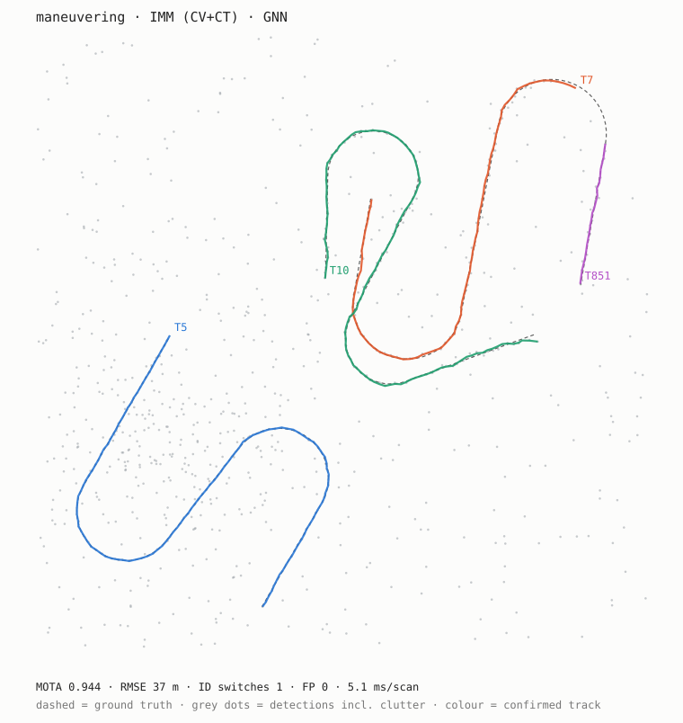
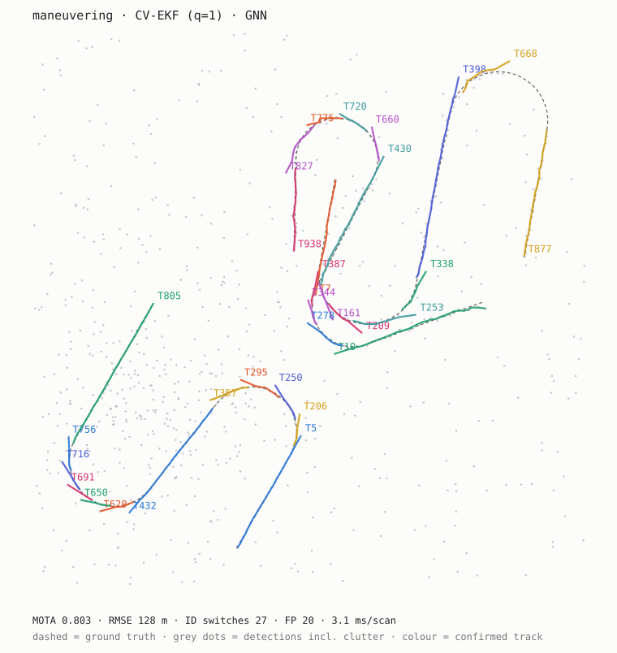
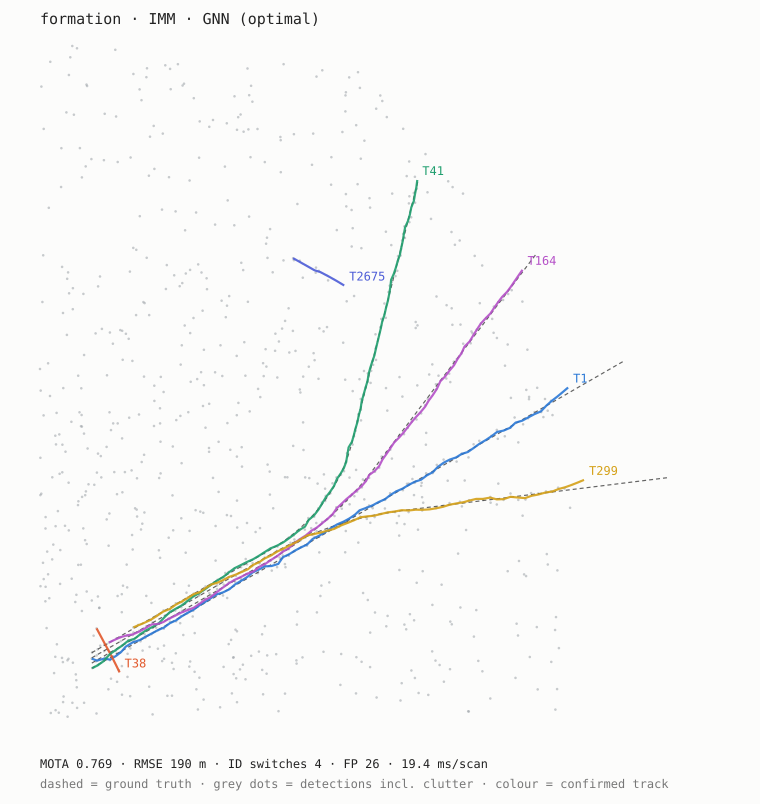
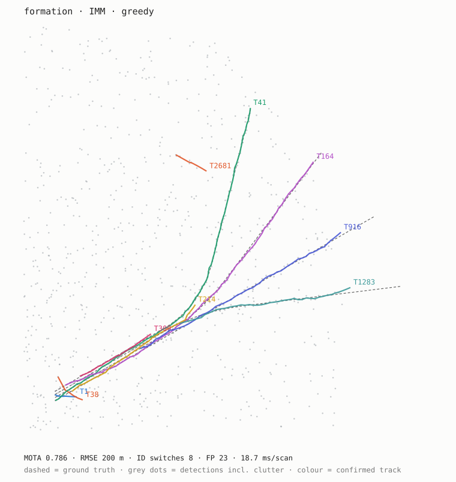
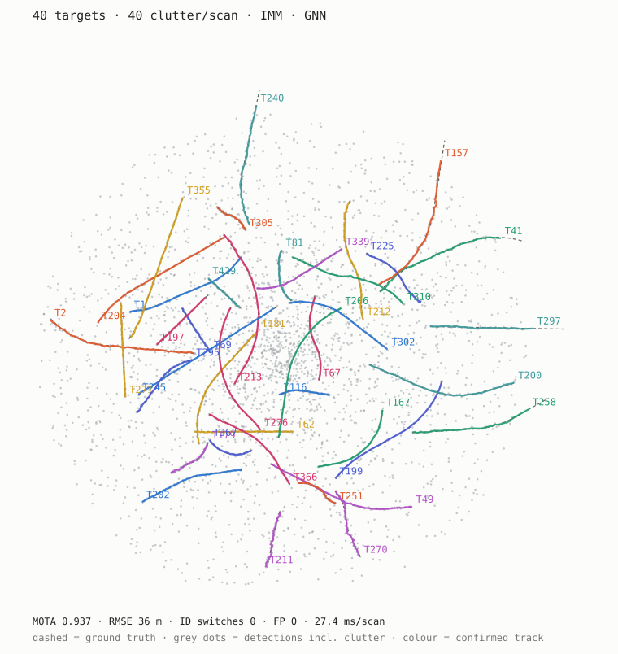

# tracklet

A multi-target tracker for a 2-D surveillance radar, built from first principles in Python + NumPy: an **IMM estimator** (constant-velocity and coordinated-turn EKFs), **Global Nearest Neighbour association** with a from-scratch **Jonker-Volgenant/Hungarian solver**, chi-square gating, **M-of-N track management**, a Monte Carlo **scenario simulator** with clutter and missed detections, and standard **OSPA / CLEAR-MOT** scoring.

This is the classic pipeline that sits behind air-surveillance radars, counter-UAS systems and the perception stacks of autonomous vehicles:

```
detections ──► predict (IMM) ──► gate (Mahalanobis χ²) ──► associate (GNN / Hungarian) ──► update (EKF) ──► manage (M-of-N)
```

<p align="center">
  
  
</p>

*Same radar data, same association. **Left:** the IMM holds one continuous track per aircraft through repeated 2.7 g turns. **Right:** a constant-velocity filter falls behind in each turn, loses the target from its gate, and breaks into dozens of fragments (25 ID switches on average).*

## Results

All numbers are averages over 10 Monte Carlo runs. Regenerate them with `python -m tracklet.experiments`. The radar has σ_range = 15 m, σ_bearing = 0.3° (about 50 m cross-range at 10 km), detection probability 0.9, and Poisson clutter.

### 1. Motion model: why IMM

Three aircraft fly straight legs alternating with 2.7 g coordinated turns, with 10 clutter points per scan.

| filter | RMSE on straight legs | RMSE in turns | overall RMSE | MOTA | ID switches |
|---|---|---|---|---|---|
| CV-EKF, low process noise (q=1) | 69 m | 177 m | 125 m | 0.804 | 25.1 |
| CV-EKF, high process noise (q=1000) | 48 m | 65 m | 55 m | 0.938 | 1.1 |
| **IMM (CV + CT)** | **38 m** | **55 m** | **46 m** | **0.940** | 1.5 |

A single-model filter forces a choice. Low process noise is smooth on straight legs but lags and loses the target in turns. High process noise keeps up in turns but is noisy the rest of the time. The IMM avoids the choice: it runs both models and weights them by how well each explains each new detection, which gives **21% lower error on straight legs and 15% lower in turns** than the best-tuned single model. A unit test confirms that the coordinated-turn probability rises when the aircraft actually turns.

### 2. Data association: when optimal assignment matters

<p align="center">
  
  
</p>

| scenario | association | MOTA | ID switches | RMSE |
|---|---|---|---|---|
| 4 aircraft, 150 m line-abreast formation that fans out, 40 clutter/scan | greedy nearest-neighbour | 0.794 | 6.5 | 167 m |
| | **GNN (Hungarian)** | **0.838** | **1.3** | **77 m** |
| 4 well-separated crossing targets, 60 clutter/scan | greedy nearest-neighbour | 0.816 | 0.8 | 41 m |
| | GNN (Hungarian) | 0.814 | 0.8 | 41 m |

This is an honest null result as well as a win. When the gates don't overlap, greedy assignment picks the same pairs as the optimal solver, so the extra machinery buys nothing. In a tight formation, the 150 m spacing is about 3x the cross-range noise, so every detection falls inside several gates. There, picking the globally best assignment instead of grabbing the closest pair first **cuts ID switches by 5x and halves the error**. (The figure shows a single run; the table averages 10.)

### 3. Real-time budget

| scene | mean per scan | p99 per scan | MOTA |
|---|---|---|---|
| 25 targets + 40 clutter | 23 ms | 33 ms | 0.911 |
| 50 targets + 40 clutter | 29 ms | 38 ms | 0.922 |
| 100 targets + 40 clutter | 46 ms | 68 ms | 0.923 |
| 200 targets + 40 clutter | 77 ms | 132 ms | 0.926 |

These are single-threaded Python timings against a 1 s scan period, so 200 targets run in real time with about 7x headroom. The cost scales roughly linearly with the number of tracks and is dominated by the per-track IMM math, not by assignment.

<p align="center"></p>

### 4. An optimization that didn't pay off

I expected splitting the gated assignment problem into independent clusters (connected components of the gate graph) to be a big speedup. I measured it with the solver alone, N tracks × N detections, at constant density:

| N | clusters | largest cluster | one global solve | per-cluster solves |
|---|---|---|---|---|
| 200 | 131 | 6 | 4 ms | 7 ms |
| 1000 | 697 | 6 | 30 ms | 41 ms |
| 4000 | 2782 | 9 | 316 ms | 240 ms |

It barely helps. With a cheap "missed detection" column for every track and +∞ outside the gates, each augmenting path in the JV solver ends within a few steps, so the global solve is already close to linear in practice. Python's per-cluster overhead cancels most of the remaining gain. Clustering stays in the tracker because it is exact (tested) and makes clusters independent units of work that could run in parallel, but it isn't a speed claim.

## Design

| Module | Contents |
|---|---|
| `motion.py` | CV and coordinated-turn models over a shared state `[x, vx, y, vy, ω]`, with analytic Jacobians (including the ω → 0 limit via Taylor expansion), discretized white-noise-acceleration Q |
| `sensor.py` | Range/bearing radar: measurement model and Jacobian, bearing-wrap-safe residuals, polar→Cartesian conversion with covariance, detection/clutter simulation |
| `filters.py` | IMM: mixing → mode-matched EKF predict/update (Joseph form) → likelihood-based mode probabilities → moment-matched output. A one-model IMM is exactly an EKF, so the baseline uses the same code. |
| `assignment.py` | Rectangular linear assignment (shortest augmenting path with dual variables, inner loop vectorized), plus union-find gate clustering |
| `tracker.py` | Gating, two-stage cascade (confirmed tracks claim detections before tentative ones), GNN or greedy association, single-detection track birth, M-of-N confirmation, deletion on misses or covariance blow-up |
| `scenarios.py` | Deterministic flight plans: maneuvering, crossing, formation, dense |
| `metrics.py` | OSPA (cutoff c, order p) and CLEAR-MOT (MOTA, MOTP, ID switches with persistent correspondences) |
| `svg.py` | Dependency-free plots |

Details worth calling out:
* **Bearing wrap.** Every innovation wraps the bearing difference into [-π, π). Without that, a target crossing due west (±180°) produces a 360° innovation and the filter diverges. A test flies a target straight through that discontinuity.
* **Joseph-form covariance update** `(I-KH)P(I-KH)ᵀ + KRKᵀ` keeps P symmetric positive-definite under floating-point error, where the textbook `(I-KH)P` can drift.
* **Assignment with a "miss" option.** The cost matrix is `[d² | diag(gate)]`, so each track can stay unassigned for exactly the gate threshold. That makes the problem always feasible and makes "no detection" a first-class hypothesis, not a fallback.
* **The cascade matters.** Without it, a tentative track spawned on a clutter point last scan can win a detection that belongs to an established track.

## Testing

`python -m unittest discover -s tests -v` runs 16 tests in about 15 s:

* **Assignment solver vs. brute force** on 300 random rectangular matrices with ties and forbidden (+∞) entries, including infeasible ones.
* **Filter consistency (NEES).** Over 60 Monte Carlo runs, the normalized estimation error squared averages to the state dimension (4) within its χ² confidence band. This is the standard check that a Kalman filter's reported uncertainty is honest, not just that its estimates are close.
* **Model math.** CT Jacobian vs. finite differences (including near ω = 0), CT → CV as ω → 0, a full-circle turn returns to its start at constant speed, radar Jacobian, and angle wrapping.
* **IMM mixing invariant.** Mixing must not move the combined estimate. This catches a non-interacting "IMM" that the end-to-end tests miss.
* **End-to-end.** Perfect tracking of clean crossings (0 ID switches, 0 false tracks), fewer than 15 confirmed false tracks from 3,000 clutter points, the ±180° bearing crossing, GNN beating greedy in formation, and OSPA/MOT metric properties.

I sanity-checked the suite with mutation testing: removing the bearing wrap, the IMM mixing, the ω-Jacobian term or the solver's dual update each make it fail.

## Run it

```bash
pip install numpy
python -m unittest discover -s tests
python -m tracklet.run --scenario maneuvering --motion imm --svg out.svg
python -m tracklet.run --scenario formation --association greedy
python -m tracklet.experiments          # regenerates every table and figure (~2 min)
```

## What I'd add next

* **JPDA / MHT:** soft or deferred association for the formation case, where even GNN commits to a wrong hard decision sometimes.
* **Vectorize the IMM across tracks** (batched `einsum` over a `[tracks, models, 5, 5]` tensor). The scaling table shows per-track Python loops are the bottleneck.
* **Range-rate (Doppler) measurements:** a third measurement dimension that makes crossing targets with different radial velocities trivially separable.
* **Multi-sensor fusion:** asynchronous measurements from several radars at different positions, with out-of-sequence handling.
* A C++ port of the hot loop with pybind11 bindings.
